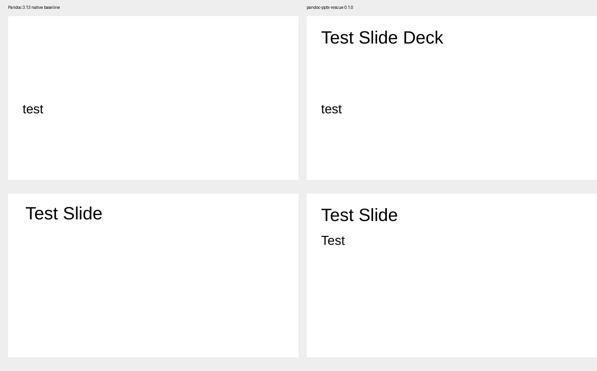

# pandoc-pptx-rescue

Build Markdown with an existing PowerPoint reference when Pandoc 3.13 drops reference files or loses the title and body of a LibreOffice-edited template.

The CLI restores missing files from the exact reference and handles one demonstrated title-placeholder mismatch. It reports every restored part and every changed title layout as JSON. Original inputs and existing output files are preserved.



The image uses the original reference from [Pandoc issue 10085](https://github.com/jgm/pandoc/issues/10085), the included short Markdown example, Pandoc 3.13 and LibreOffice 26.8.1.1 on macOS. It shows a specific two-slide result, not a general PowerPoint compatibility guarantee.

## Install from a checkout

Requirements: Python 3.11 or later, and **exactly Pandoc 3.13** installed separately from the [official releases](https://github.com/jgm/pandoc/releases/tag/3.13). The Python package has no runtime dependencies. The commands below use a macOS/Linux shell with Python 3.12.

```sh
python3.12 -m venv .venv
. .venv/bin/activate
python -m pip install .
```

## Reproduce the original failure and recovery

From the repository root, download the author's public reference:

```sh
curl --fail --location \
  https://github.com/user-attachments/files/16603810/templateLOmac.pptx \
  --output reference.pptx
```

The 59,965-byte reference has SHA256 `4ba4ac09a81247248d08c3ee63f908fac5e03cd7a6b662918a94d061f44e30d1`.

Build into a new output path:

```sh
pandoc-pptx-rescue build examples/slides.md \
  --reference reference.pptx \
  --output recovered.pptx \
  --format json
```

If Pandoc is outside `PATH`, add `--pandoc /absolute/path/to/pandoc`. The input is Markdown, and image paths are resolved from its directory. Pandoc uses fixed `markdown` to `pptx` options; this CLI does not accept arbitrary Pandoc flags.

For this reference, the report has 20 entries in `restored_parts`, one entry in `reference_parts_normalized`, and an empty `missing_after` list. `changed_generated_parts` contains only `[Content_Types].xml`. `restored_parts_match_reference` is `true`.

Open `recovered.pptx` in the intended presentation application. In the tested LibreOffice rendering, the expected title, subtitle, heading and body are visible. Compare the native Pandoc baseline with the same input:

```sh
pandoc examples/slides.md --reference-doc=reference.pptx --output=baseline.pptx
```

That baseline omits 20 relationship targets and displays the subtitle and heading while losing the title and body in the tested consumer. The [evidence notes](docs/evidence.md) distinguish this visual recovery from metadata-only cases.

Use the same Pandoc 3.13 executable for both commands. If it is outside `PATH`, replace `pandoc` in the baseline command with that executable's path.

## Using it from an agent

Use `--format json`, read the process exit code, then inspect `status`, `restored_parts`, `reference_parts_normalized`, `changed_generated_parts` and `pandoc_log`. Exit 0 means an output was written with no missing internal relationship targets. It does not mean every Office feature was validated.

| Exit | Meaning |
|---|---|
| 0 | Output written, package audit included |
| 1 | Conversion or I/O failure, diagnostic message included |
| 2 | Unsupported input, version, source dependency or existing output path |

Runtime failures return JSON with `status`, `error.code`, `error.message` and `output_written: false`. Argument syntax errors use argparse's normal stderr output and exit 2.

The default human output summarizes restored files, normalized layouts, remaining missing targets and Pandoc warnings. Use `pandoc-pptx-rescue build --help` for all flags.

## Scope and limits

- Tested with Pandoc 3.13, Python 3.12.13 and LibreOffice 26.8.1.1 on macOS Apple Silicon. Native Microsoft PowerPoint and Windows/Linux execution have not been verified.
- This rebuilds from Markdown plus the exact reference. It cannot recover text already omitted from an existing generated presentation without rebuilding.
- It copies exact missing source parts without replacing existing generated assets. Missing source files or dependency/content-type collisions produce an unsupported result.
- Title normalization changes a sole `title` placeholder to `ctrTitle` only in a layout named `Title Slide` that lacks `ctrTitle`. Other template problems remain outside this operation.
- It checks bounded ZIP/XML input and internal relationship targets. Full OOXML schema validation, animations, charts, accessibility, signatures and general layout fidelity are not established. The research package validator still flagged unreferenced parts after source recovery.
- Signed packages and VBA projects are unsupported. Limits: 64 MiB compressed, 128 MiB expanded, 32 MiB per part, 8 MiB per XML part and 4,096 ZIP entries. XML is UTF-8, without DTD/entity declarations, with bounded depth and element count.
- Pandoc processes the supplied Markdown and may read its referenced resources. This tool is not a sandbox for untrusted Markdown or the Pandoc executable.
- Output parent directories must exist. Choose a fresh output filename for each build; the CLI does not overwrite an existing file.

## Development

```sh
python -m unittest discover -s tests -v
```

These controls use authored package fixtures for failure handling. Original public references and native-rendering evidence are documented separately. See [contributing](CONTRIBUTING.md) for a useful bug report.

MIT licensed. Independent project, with no official affiliation to Pandoc, LibreOffice or Microsoft.
